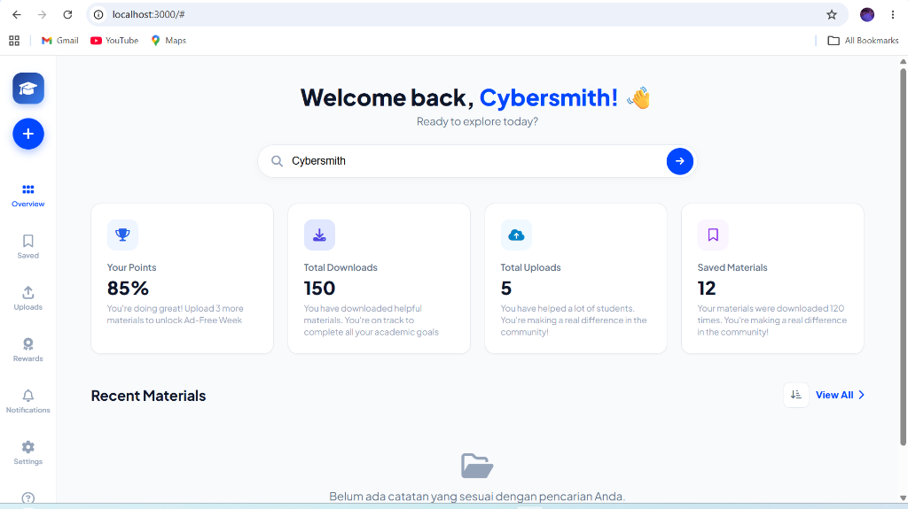
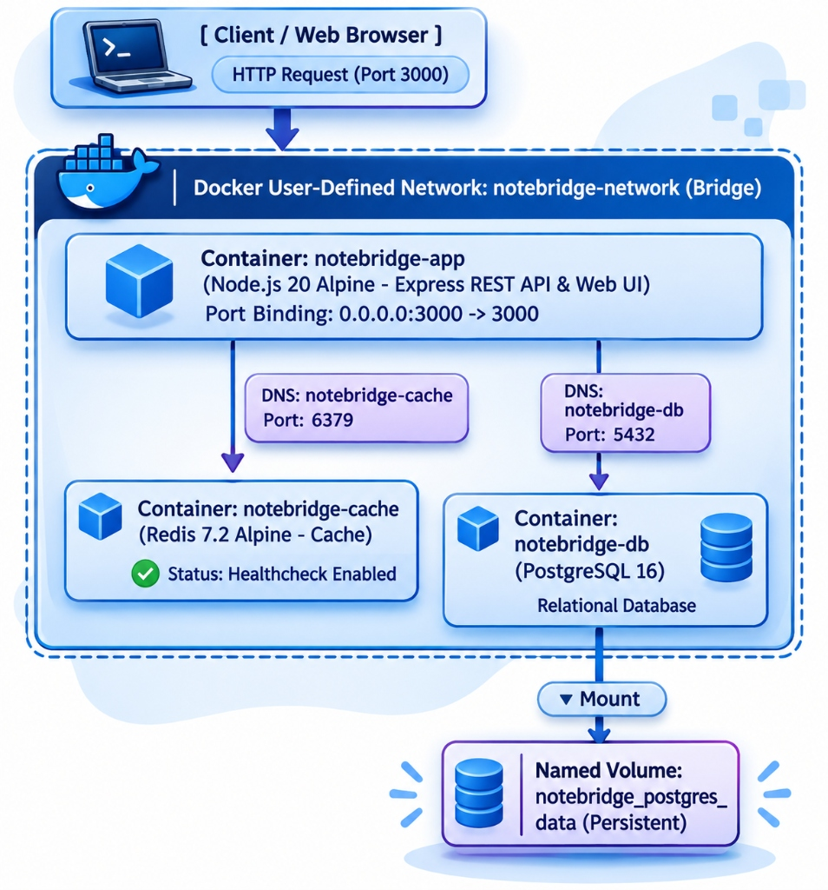

# NoteBridge

[](https://www.docker.com/)
[](https://docs.docker.com/compose/)
[](https://nodejs.org/)
[](https://www.postgresql.org/)
[](https://redis.io/)
[](https://binus.ac.id/)

> **Platform Berbagi, Mencari, dan Mengakses Catatan Perkuliahan Terpusat Berbasis Cloud-Native**  
> Tugas Ujian Tengah Semester (UTS) — Mata Kuliah: **COMP6991031 – Cloud Services**  
> Program Studi: **Computer Science — BINUS University (Kelas LA75)**

---

## Tampilan Antarmuka Aplikasi (Web Dashboard)

Berikut adalah tampilan antarmuka web interaktif **NoteBridge** yang berjalan di container `localhost:3000`:



> **Fitur Dashboard yang Terlihat:**
> 1. **Header Sapaan Personalisasi**: *"Welcome back, Cybersmith!"* menyambut mahasiswa secara interaktif.
> 2. **Metrik & Gamifikasi Akademik**:
>    - **Your Points (85%)**: Sistem motivasi akademik untuk membuka minggu bebas iklan.
>    - **Total Downloads**: Menampilkan akumulasi dokumen yang telah diunduh mahasiswa.
>    - **Total Uploads**: Menghitung jumlah catatan yang telah dipublikasikan ke platform.
>    - **Saved Materials**: Bookmark catatan favorit untuk referensi belajar sebelum ujian.
> 3. **Smart Search Bar**: Pencarian instan berdasarkan kode mata kuliah (*Course Code* seperti `CSC 204`, `MTH 202`) atau nama judul catatan.
> 4. **Recent Materials Grid**: Kartu-kartu catatan perkuliahan lengkap dengan lencana kode matkul, nama kontributor, deskripsi, dan tombol unduh PDF.

---

## 1. Latar Belakang & Masalah (Problem Statement)

### Permasalahan
Dalam dinamika perkuliahan di perguruan tinggi, mahasiswa sering mengalami kendala aksesibilitas materi:
* **Ketidakhadiran karena Sakit**: Mahasiswa yang berhalangan hadir kuliah kesulitan mengejar ketertinggalan penjelasan materi dosen.
* **Materi yang Rumit**: Mahasiswa yang membutuhkan sudut pandang penjelasan berbeda kesulitan menemukan catatan rekan sejawat.
* **Persiapan Menjelang Ujian**: Menjelang UTS/UAS, mahasiswa membutuhkan rangkuman materi ringkas dan terstruktur.
* **Catatan Tercecer**: Catatan kuliah selama ini tersebar secara acak di berbagai grup WhatsApp, tautan Google Drive pribadi, atau *direct message* yang mudah tenggelam dan sulit ditemukan kembali.

### Solusi: NoteBridge
**NoteBridge** menyediakan solusi terpusat (*one-stop academic platform*) agar mahasiswa dapat mengunggah, mencari, melihat, dan mengunduh catatan perkuliahan secara terstruktur, cepat, dan aman.

---

## 2. Empat Fitur Utama (Minimum Viable Product - MVP)

1. **Upload Notes (Unggah Catatan)**:  
   Mahasiswa dapat mengunggah catatan PDF dengan melampirkan metadata terstruktur: judul catatan, kode mata kuliah, nama penulis, dan deskripsi materi.
2. **Browse & Search Notes (Pencarian & Penjelajahan)**:  
   Pencarian instan berbasis kata kunci judul, kode matkul, maupun nama kontributor dengan dukungan *caching* Redis untuk kecepatan respons tingkat tinggi.
3. **View & Download Notes (Lihat & Unduh)**:  
   Melihat pratinjau informasi catatan perkuliahan serta mengunduh dokumen secara instan (sekaligus meng-update metrik unduhan).
4. **My Uploads (Kelola Unggahan Saya)**:  
   Navigasi cepat untuk melihat seluruh riwayat materi yang pernah diunggah oleh mahasiswa yang bersangkutan.

---

## 🏗️ 3. Arsitektur Sistem Multi-Tier & Alur Data

Aplikasi NoteBridge dirancang dengan arsitektur cloud-native multi-tier yang terisolasi dalam container menggunakan Docker & Docker Compose:



### Komponen & Alur Arsitektur:
1. **Client / Web Browser**: Mahasiswa mengakses antarmuka aplikasi melalui request HTTP pada port host `3000`.
2. **Container Application (`notebridge-app`)**: Dibangun dengan base image `node:20-alpine3.19` yang melayani antarmuka web dan Express REST API dengan port binding `0.0.0.0:3000 -> 3000`.
3. **Docker User-Defined Network (`notebridge-network`)**: Jaringan bridge privat yang memfasilitasi komunikasi antarkontainer secara aman via internal DNS service name tanpa mengekspos port database ke jaringan publik.
4. **Container Cache (`notebridge-cache`) — *Fitur Bonus UTS (+5 Poin)***: Berbasis `redis:7.2-alpine` pada port `6379` dengan healthcheck aktif untuk menyimpan cache kueri pembacaan data (`GET /api/notes`) demi mereduksi latensi respons.
5. **Container Database (`notebridge-db`)**: Berbasis `postgres:16-alpine` pada port `5432` sebagai basis data relasional utama untuk menyimpan katalog dan metadata catatan perkuliahan.
6. **Named Volume (`notebridge_postgres_data`)**: Dipetakan (*mounted*) ke `/var/lib/postgresql/data` pada database container untuk menjamin persistensi data catatan tetap utuh meskipun container dimatikan (`docker compose down`).
7. **Database Management GUI (`adminer`) — *Profile Tools***: Tersedia via profil terisolasi `tools` pada port `8080` untuk inspeksi basis data secara visual jika dibutuhkan.

---

## 🚀 4. Panduan Menjalankan Aplikasi di Localhost

Aplikasi dirancang agar dapat dijalankan secara instan dengan **satu perintah**:

### Prasyarat
* [Docker Desktop](https://www.docker.com/products/docker-desktop/) telah terpasang dan dalam status aktif (*Engine running*).
* Git terpasang di sistem operasi Anda.

### Langkah Instalasi

# 1. Clone repositori ini
```bash
git clone https://github.com/<USERNAME>/NoteBridge.git
cd NoteBridge
```

# 2. Siapkan berkas environment (tanpa mengekspos kredensial rahasia)
```bash
cp .env.example .env
```
# (Untuk pengguna Windows PowerShell: Copy-Item .env.example .env)

# 3. Jalankan seluruh container
```bash
docker compose up -d --build
# (atau: docker-compose up -d --build)
```

Setelah proses build selesai:
* 🌐 **Aplikasi Web**: Buka browser di [http://localhost:3000](http://localhost:3000)
* 🩺 **Healthcheck Endpoint**: [http://localhost:3000/health](http://localhost:3000/health)
* 🛠️ **Adminer Database GUI (Opsional)**:
  ```bash
  docker compose --profile tools up -d
  ```
  Lalu buka [http://localhost:8080](http://localhost:8080) (System: PostgreSQL, Server: `notebridge-db`, Username: `notebridge_user`, Password & Database sesuai `.env`).

---

## 5. Dokumentasi Endpoint REST API

| Method | Endpoint | Deskripsi | Status Code | Respon Sukses |
|---|---|---|---|---|
| `GET` | `/health` | Memeriksa ketersediaan aplikasi, koneksi database, dan cache | `200 OK` | `{"status":"UP","services":{"database":"HEALTHY","redis_cache":"CONNECTED"}}` |
| `GET` | `/api/notes` | Mengambil seluruh catatan (opsional query: `?search=kalkulus`) | `200 OK` | `{"source":"database/cache","count":5,"data":[...]}` |
| `POST` | `/api/notes` | Menambahkan catatan baru ke basis data & invalidasi cache | `201 Created` | `{"message":"Catatan berhasil diunggah!","data":{...}}` |
| `POST` | `/api/notes/:id/download` | Menambah jumlah download catatan & mengambil berkas | `200 OK` | `{"message":"Download berhasil dimulai","data":{...}}` |

---

## 6. Uji Persistensi Data (Data Persistence Proof)

Aplikasi menggunakan Docker Named Volume `postgres_data` yang dipetakan ke direktori internal PostgreSQL `/var/lib/postgresql/data`.

### Langkah Pengujian Persistensi:
1. Tambahkan catatan baru melalui antarmuka web [http://localhost:3000](http://localhost:3000) atau via Postman `POST /api/notes`.
2. Hentikan container dengan perintah:
   ```bash
   docker compose down
   ```
3. Nyalakan kembali container dengan perintah:
   ```bash
   docker compose up -d
   ```
4. Buka kembali browser: **Catatan baru yang telah diunggah tetap tersimpan utuh dan tidak hilang!**

> **Perbedaan Mendasar `docker compose down` vs `docker compose down -v`:**
> * `docker compose down`: Hanya mematikan dan menghapus container serta jaringan, namun **TETAP MEMPERTAHANKAN (PRESERVE)** named volume sehingga data database aman.
> * `docker compose down -v`: Menghapus container sekaligus **MENGHAPUS PERMANEN SELURUH NAMED VOLUMES**, menyebabkan seluruh catatan di dalam basis data terhapus total (*data loss*).

---

## 7. Tautan Publikasi Projek

* 📂 **GitHub Repository**: `https://github.com/[username-anda]/NoteBridge`
* 🎥 **Video Demo YouTube (3–5 Menit)**: `https://youtu.be/[id-video-anda]`
* 📝 **Artikel Publik (Medium / Dev.to)**: `https://dev.to/[username-anda]/membangun-arsitektur-cloud-native-notebridge`

---

## 8. AI Usage Declaration (Tipe: Partial)

*Sesuai ketentuan integritas akademik ujian UTS Cloud Services (Tipe Penggunaan AI: **Partial**, maks. 50% proses).*

1. **Alat AI yang Digunakan**: Google Antigravity / Gemini 3.8
2. **Tahapan & Bagian yang Dibantu**:
   - Perumusan batasan masalah dan pemetaan karakteristik esensial cloud menurut NIST.
   - Perancangan template Dockerfile *multi-stage build* (`node:20-alpine3.19`) dan konfigurasi `docker-compose.yml`.
   - Penyusunan skema basis data PostgreSQL, kueri SQL, dan optimasi Redis in-memory cache.
3. **Contoh Prompt Utama**:
   - *"Rancang konfigurasi docker-compose.yml dengan service Node.js Express, PostgreSQL 16 Alpine, dan Redis 7.2 Alpine dengan healthcheck, depends_on: service_healthy, named volume, dan user-defined bridge network."*
   - *"Bagaimana menyusun Dockerfile multi-stage build untuk aplikasi Node.js dengan base image spesifik alpine yang memisahkan dependency caching dari source code?"*
4. **Pernyataan Orisinalitas & Kemandirian**:
   - Penggunaan AI dibatasi pada perancangan arsitektur dan kerangka kode. Seluruh proses pengujian di localhost, perekaman video demo suara asli, dan penulisan artikel diselesaikan dan dipahami secara mandiri oleh mahasiswa.
